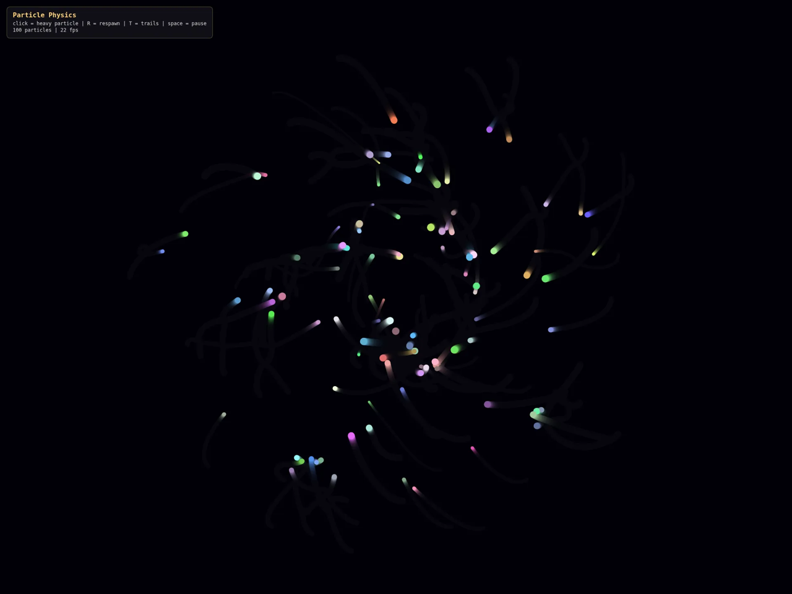
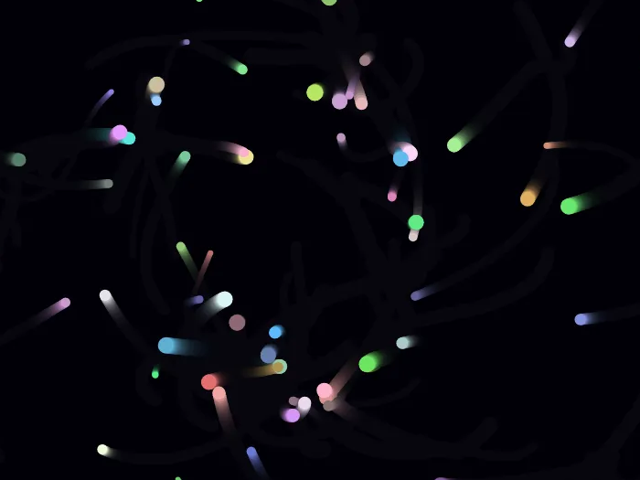

# Particle Physics
A basic Particle Physics simulation and rendering using p5.js.

Live Preview:
https://particle-physics.vercel.app/

# About the Project
All of the different particles will act like planets in orbit. They'll all apply forces (gravity) to each other depending on their mass and their distance from each other. The main difference here is that they are much closer together than real planets. This is so you don't have to wait an entire year for one particle to orbit another.

# Controls
- **Click** - drop a big heavy gold particle
- **R** - respawn all particles
- **T** - turn trails on/off
- **Space** - pause

# Tech Stack
- **p5.js** (v1.9.4) - for drawing and the vectors
- **JavaScript** - all the physics and particle logic
- **HTML + CSS** - the page and the little HUD box
- **Vercel** - hosting the live preview

# How and Why I Built It
I built this project to level up my programming skills and explore the creative possibilities of modern web development by following [this](https://workshops.hackclub.com/particle_physics/) Tutorial.

# Ready to explore?
Jump in and watch the gravity take over! It's pretty mesmerizing to see how the particles pull on each other, sling each other around, and form little chaotic solar systems right in the browser.
